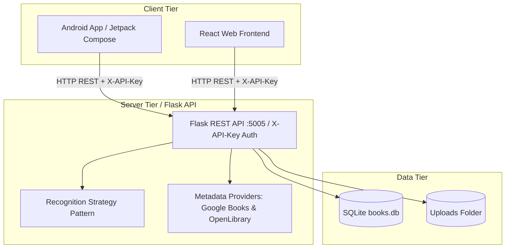

# HomeBooks — Personal Library Management System

> An intelligent, full-stack cross-platform book management system featuring an Android mobile app (Jetpack Compose), a React web frontend, and a modular Python Flask backend with AI/OCR book recognition and on-device barcode scanning.

---

## 🏗️ Architecture Overview & Significant Design Decisions

HomeBooks follows a clean monorepo architecture consisting of three primary tiers:
1. **Client Tier (Mobile & Web):**
   - **Android App:** Built with Jetpack Compose, Material 3, ViewModel, LiveData, Retrofit, and Coil. Features on-device barcode scanning (ZXing) and Google AdMob monetization.
   - **React Web App:** Built with React 19, React Router, Redux Toolkit, and Vite, served directly by the Flask backend.
2. **Server Tier (Backend):**
   - **Flask REST API (`/backend`):** Modular blueprint-based Python application (`/api/v1/books`).
   - **Strategy Pattern for Recognition:** Pluggable recognition pipeline supporting barcode and cover OCR strategies.
   - **Metadata Providers:** Google Books API with OpenLibrary fallback, backed by a size-limited in-memory cache (24-hour positive and 15-minute no-result entries), a bounded in-process FIFO request queue paced at up to three provider calls per second, `limits` per-thread quotas, and Tenacity retries.
3. **Data Tier:**
   - **SQLite (`books.db`):** Local relational database managing books and multi-image associations.



---

## 📱 Offline-First Architecture (ADR 0002)

The Android app implements an offline-first architecture for robust usage without network connectivity:
- **Local Source of Truth:** Room database caches books, sync states, and image attachments locally so reads and writes happen instantly without waiting for the server.
- **Outbox Pattern & WorkManager:** Pending mutations (`CREATE`, `UPDATE`, `DELETE`) are queued locally in Room and synchronized sequentially using WorkManager with network constraints.
- **Idempotency Keys:** Client-generated stable UUIDs are sent as `idempotency_key` on create requests to guarantee duplicate-free retries.
- **Conflict Policy:** Last-writer-wins at the book-record level upon reconnection, with visible sync status indicators in the UI.

---

## 📷 Continuous Barcode Scanning for Bulk Entry (ADR 0003)

The Android app features a dedicated continuous scanning mode for fast, uninterrupted bulk library entry:
- **Continuous Camera Session:** Powered by ZXing Android Embedded in a locked portrait orientation.
- **Session Suppression & Duplicate Checks:** Suppresses repeat frame detections during the session and checks local Room storage to skip books already present.
- **Automatic Metadata & Offline Queuing:** Automatically looks up book metadata via the backend barcode endpoint and queues successful lookups for offline-first synchronization.
- **Live Status Feedback:** Displays real-time scan status overlay ("Added", "Already exists", "Not found") while keeping the camera active for continuous scanning.

---

## 📚 Add Books from Bookshelf Photos (ADR 0005 and ADR 0006)

The Android app supports capturing or uploading a bookshelf photograph to add multiple books in batch:
- **On-Device Text Recognition:** Uses bundled Google ML Kit Text Recognition to extract text blocks locally from the selected shelf image. Source images are not sent to OpenRouter by this Android flow.
- **Reviewable OCR Candidates:** OCR blocks are provisional title candidates; authors are left blank rather than guessed. OCR does not yet include a dedicated spine detector or VLM, so users should verify and edit results.
- **Review & Edit UI:** Displays a dedicated review screen where users can inspect recognized books, edit titles/authors, deselect items, and see automatic local library duplicate warnings.
- **Batch Import:** Confirms selected books and adds them efficiently via the offline-first repository.

The backend OpenRouter recognition endpoints remain available to other clients;
the Android bookshelf flow performs image text recognition on-device.

---

## 🔒 Security & Authentication

- **API Key Header Authentication (`X-API-Key`):**
  To prevent unauthorized direct calls to the backend API, all REST endpoints (`/api/v1/books/...`) are protected by an API Key decorator (`@require_api_key`).
- **Client Enforcement:** 
  The Android Retrofit client (`RetrofitClient.kt`) automatically attaches the `X-API-Key` header to every outgoing HTTP request via an OkHttp Interceptor.

---

## 🛠️ Frameworks & Tech Stack

| Component | Technology / Library | Purpose |
| :--- | :--- | :--- |
| **Android App** | Kotlin, Jetpack Compose, Material 3 | Declarative mobile UI & navigation |
| **Networking** | Retrofit 2, OkHttp 3, Gson | REST communication with Flask API & Auth interceptors |
| **Image Loading** | Coil 2.5 | Async image loading, caching, and full-screen pager |
| **Barcode Scanner** | ZXing Android Embedded | On-device ISBN barcode scanning via camera |
| **Web Frontend** | React 19, Vite, Redux Toolkit, React Router | Web dashboard and book management |
| **Backend API** | Python 3, Flask, Gunicorn | REST API, auth middleware, and static web server |
| **Image Processing** | Pillow | Automatic image resizing and JPEG compression |
| **Database** | SQLite, Raw SQL / DB Connection | Persistent local relational storage |

---

## 🗄️ Database Schema

- **`book` Table:** Stores book metadata (`id`, `barcode`, `title`, `author`, `release_date`, `description`, `thumbnail`).
- **`book_images` Table:** Stores associated image paths for each book (`id`, `book_id`, `image_url`).

---

## 🔌 API Endpoints (Protected by `X-API-Key`)

| Method | Endpoint | Description |
| :--- | :--- | :--- |
| `GET` | `/api/v1/books` | List all library books with images |
| `GET` | `/api/v1/books/<id>` | Get book details by ID |
| `POST` | `/api/v1/books` | Add a new book with multipart images |
| `PUT` | `/api/v1/books/<id>` | Update book details and manage images |
| `DELETE` | `/api/v1/books/<id>` | Delete a book and clean up storage files |
| `POST` | `/api/v1/books/recognize` | AI/OCR image recognition & metadata matching |
| `GET` | `/api/v1/books/barcode/<isbn>` | Search book metadata by scanned barcode |
| `GET` | `/uploads/<filename>` | Serve uploaded book cover / gallery images |

---

## ✨ Main App Functions

1. **Book List & Real-Time Search:** Instant filtering by title or author.
2. **Swipe-to-Delete:** Material 3 dismiss actions to remove books.
3. **Multi-Image Staging & Management:** Add photos via Gallery or Camera, with individual image removal via long-press or 'X' button.
4. **On-Device Barcode Scanning:** Fast local barcode scanning to instantly fetch book info.
5. **AI/OCR Recognition:** Pluggable strategy pipeline (Google Books primary, OpenLibrary fallback, cover OCR).
6. **Full-Screen Image Gallery:** Horizontal pager with zoom/fit and swipe navigation.
7. **Monetisation:** Google AdMob Rewarded Ads (~30s) triggered after every 5th successful book addition.
8. **Automatic Image Compression & Resizing:** Uploaded photos are automatically resized (max 1200px) and compressed as optimized JPEGs (80% quality) on the backend to conserve Raspberry Pi SD card storage.

---

## 🧪 Testing Strategy

- **Backend Unit Tests:** Pytest for Flask routes, repositories, and recognition strategies.
- **Android Unit & UI Tests:** JUnit, Espresso, and Compose UI testing for ViewModels and Composable screens.

---

## 🚀 CI/CD & Deployment

- **Raspberry Pi Hosting (`192.168.178.37`):** Runs as a local Wi-Fi bridge service via Systemd and Gunicorn.
- **Automated Deployment (`deploy.sh` & Webhook):** GitHub push events trigger automated pull, frontend Vite build, dependency updates, and service restart.

---

## 📖 Runbook

### Local Development
```bash
# 1. Run Backend
cd backend
python3 -m venv .venv
source .venv/bin/activate
pip install -r requirements.txt
python run.py

# 2. Run Frontend
cd frontend
npm install
npm run dev

# 3. Run Android App
# Open homebooks-android in Android Studio and run on emulator/device.
```

### Production Deployment (Raspberry Pi)
```bash
# One-time setup on Raspberry Pi
cd /home/pi/Cloud-Native-Python
sudo cp deploy/homebooks-backend.service /etc/systemd/system/
sudo systemctl daemon-reload
sudo systemctl enable --now homebooks-backend
```

### Configure OpenRouter Image Recognition (Raspberry Pi)
Image recognition uses OpenRouter from the backend. Configure the API key on the
Raspberry Pi in a root-owned environment file; do not commit the key or put it
in the Android or frontend application.

```bash
sudo install -d -m 700 /etc/homebooks
sudo install -m 600 /dev/null /etc/homebooks/homebooks-backend.env
sudoedit /etc/homebooks/homebooks-backend.env
```

Add the following entries, replacing the placeholder with your OpenRouter API
key:

```dotenv
OPENROUTER_API_KEY=your_openrouter_api_key
OPENROUTER_MODEL=nvidia/nemotron-3.5-super-vl:free
```

`OPENROUTER_MODEL` may be `openrouter/free` or a specific free model ID ending
in `:free`. The free router selects an available free model that supports image
input and structured JSON output; a specific model must support those features
itself. Free model availability and rate limits can change. Restart the service
to load the settings:

```bash
sudo systemctl daemon-reload
sudo systemctl restart homebooks-backend
sudo systemctl status homebooks-backend --no-pager
```

### Viewing Backend Logs (Raspberry Pi)
To stream live logs from the background systemd service:
```bash
sudo journalctl -u homebooks-backend -f
```

To view the last 100 log lines:
```bash
sudo journalctl -u homebooks-backend -n 100 --no-pager
```

### Serve the Raspberry Pi backend through a Cloudflare Tunnel

The HomeBooks service is available at `https://homebooks.us.ci` through the
`homebooks` Cloudflare Tunnel. The `cloudflared` service runs on the Raspberry
Pi and connects out to Cloudflare; the tunnel forwards requests to the local
Gunicorn service on port `5005`. This does not require opening or forwarding
port `5005` on the router.

#### Configure the tunnel route

The Raspberry Pi must already be running the backend and the Cloudflare Tunnel
must be installed and connected to your Cloudflare account. In the Cloudflare
dashboard:

1. Open **Zero Trust → Networks → Tunnels** and select the `homebooks` tunnel.
2. Add or edit a **Published application route**.
3. Set the public hostname to `homebooks.us.ci` (leave the subdomain blank for
   the root domain).
4. Set the service type to **HTTP** and the service URL to
   `http://localhost:5005`. Because `cloudflared` and Gunicorn run on the same
   Pi, `localhost` points to the backend.
5. Save the route. Cloudflare should create or associate the DNS Tunnel record
   for `homebooks.us.ci`; confirm it is proxied in the domain's DNS records.

If the domain is managed at a separate registrar, its DNS/nameserver setup must
also direct the domain to Cloudflare. Do not point a public DNS record at the
Pi's private LAN address.

#### Verify connectivity

On the Pi, confirm the backend responds locally and the tunnel service is
running:

```bash
curl -I http://127.0.0.1:5005/
sudo systemctl status cloudflared --no-pager
```

Then test the public hostname from a device outside the Pi:

```bash
curl -I https://homebooks.us.ci/
```

The public URL uses HTTPS at Cloudflare; the tunnel can connect to the local
backend over HTTP. Cloudflare Tunnel does not add application-level
authentication by itself. Keep the app's API authentication enabled, and use
Cloudflare Access as an additional layer if the site should only be available
to authenticated visitors.

If the public request fails, first check the local backend, then the tunnel's
health and route in the Cloudflare dashboard. Tunnel service logs are available
with:

```bash
sudo journalctl -u cloudflared -n 100 --no-pager
```
